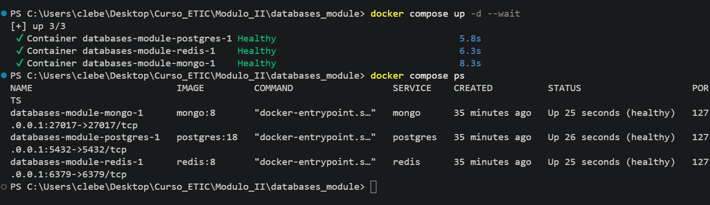

# Exercício 01 — Diagnóstico de uma loja guardada num ficheiro JSON

Ficheiros: `README.md` (este), `shop.json` (o ficheiro do enunciado, igual, para os números de linha baterem), `image.png`.

## 1. `docker compose ps`

## 2. Modelo de dados de `shop.json`

Três entidades, cada uma numa lista:

| Entidade | Campos | Chave |
|---|---|---|
| `customers` | `id`, `name`, `email`, `city` | `id` |
| `orders` | `id`, `customer_id`, `customer_name`, `customer_email`, `items`, `total`, `date` | `id` (devia ser único, mas não é) |
| `products` | `name`, `price`, `stock` | nenhuma (usa-se o `name`) |

Relações:

- **cliente 1 — N encomendas:** `orders.customer_id` aponta para `customers.id`.
  A encomenda também copia o nome e o email do cliente.
- **encomenda N — N produtos:** não existe como estrutura. Está escondida no texto
  `items` (`"Keyboard x1; Mouse x2"`), que liga as encomendas aos produtos pelo **nome**
  e junta a quantidade no mesmo texto.

## 3. Problemas concretos

| Linha | Tipo de problema | O que está mal | O que pode correr mal |
|---|---|---|---|
| 7 | dados duplicados | `customer_name` e `customer_email` copiam dados que já estão em `customers` | se o cliente mudar de email, as encomendas antigas ficam com o valor antigo |
| 11 | dados duplicados (já inconsistentes) | o email do cliente 1 é `ana.silva@example.com`, mas na linha 3 é `ana@example.com` | ninguém sabe qual é o email certo |
| 9 | falta de regra de integridade (chave estrangeira) | `customer_id: 3` não existe em `customers` | encomenda de um cliente que não existe; impossível faturar ou contactar |
| 11 | falta de regra de integridade (chave única) | há duas encomendas com `id: 2` (linhas 9 e 11) | "a encomenda 2" pode ser qualquer uma; atualizar ou apagar uma afeta a outra |
| 9 | falta de regra de validação | `customer_email: "marta@example"` não é um email válido | não se consegue enviar a fatura |
| 10 | tipo errado | `total: "abc"` | somar as vendas falha ou dá um valor errado |
| 8 e 12 | formato inconsistente / tipo errado | `total` é texto `"59.90"` na linha 8 e número `12.5` na linha 12 | cada leitura tem de adivinhar o tipo; `"59.90" + 12.5` não é uma soma |
| 8, 10 e 12 | formato inconsistente | datas `"07/10/2026"` (linhas 8 e 12) e `"2026-10-08"` (linha 10) | `07/10` pode ser 7 de outubro ou 10 de julho; ordenar por data não funciona |
| 8 | lista guardada num só campo | `items: "Keyboard x1; Mouse x2"` | não dá para perguntar "quantos ratos se venderam" sem partir o texto; um erro de escrita no nome passa despercebido |
| 12 | falta de regra de validação | `"Mouse x-1"`: quantidade negativa | uma encomenda que "devolve" stock sem ninguém dar conta |
| 15 | tipo errado (dinheiro em float) | `price: 29.90` como número de vírgula flutuante | 0.1 + 0.2 ≠ 0.3: os totais ficam com erros de arredondamento |
| 16 | tipo errado | `price: "15"` é texto | comparar ou somar preços dá resultados errados |
| 16 | falta de regra de validação | `stock: -2` | vende-se o que não existe |
| 14–16 | falta de chave | os produtos não têm `id`; as encomendas referem-se a eles pelo nome | mudar o nome de um produto parte as encomendas antigas |

(São 14 problemas de 6 tipos diferentes.)

## 4. 100 000 encomendas e duas encomendas ao mesmo tempo

**100 000 encomendas.** A aplicação lê o ficheiro inteiro, muda-o em memória e escreve-o inteiro em cada pedido.

- *Encontrar as encomendas de um cliente:* não há índice, por isso é preciso carregar
  e percorrer as 100 000 encomendas (dezenas de MB) em cada pedido, só para devolver meia dúzia.
- *Juntar uma encomenda:* para acrescentar ~200 bytes, lê-se e reescreve-se o ficheiro
  inteiro. Cada pedido fica mais lento à medida que o ficheiro cresce. Se a aplicação morrer a
  meio da escrita, o ficheiro fica cortado e perde-se **tudo**, não só a última encomenda.

**Dois pedidos ao mesmo tempo.** Os dois leem o ficheiro com, por exemplo, 3 encomendas.
Cada um acrescenta a sua em memória e escreve o ficheiro de volta com 4 encomendas. O que
escrever por último apaga a encomenda do outro (*lost update*). Também podem os dois escolher
o mesmo `id` novo (como o `id: 2` repetido), e um pode ler o ficheiro enquanto o outro o está a
escrever e encontrar JSON inválido. Não há nada que coordene os dois pedidos.

## 5. Que motor para cada dado

| Dado | Motor | Porquê |
|---|---|---|
| clientes | **PostgreSQL** | dados que não se podem perder nem contradizer: email único, chave primária, e são referidos pelas encomendas |
| encomendas | **PostgreSQL** | dinheiro e stock: precisam de transações ACID (gravar a encomenda e baixar o stock juntos, ou nada), chaves estrangeiras para clientes e produtos, `numeric` para o total e `CHECK` nas quantidades |
| produtos | **PostgreSQL** | preço e stock têm de ser exatos e consistentes com as encomendas (`CHECK (stock >= 0)`). Se cada produto tivesse atributos muito diferentes (um catálogo variável), essa parte podia ir para o **MongoDB** |
| os últimos 10 produtos que um cliente viu | **Redis** | muda a cada clique, só se lê inteira, pode expirar e, se se perder, não é grave. Uma lista ou sorted set por cliente com `LTRIM`/`ZREMRANGEBYRANK` mantém só os 10 últimos |
| quantas vezes cada página de produto foi aberta hoje | **Redis** | um contador que muda muitas vezes por segundo: `INCR` em memória é atómico e muito rápido, e a chave pode expirar no fim do dia. Escrever isto numa tabela a cada visita era muito trabalho para o PostgreSQL |
