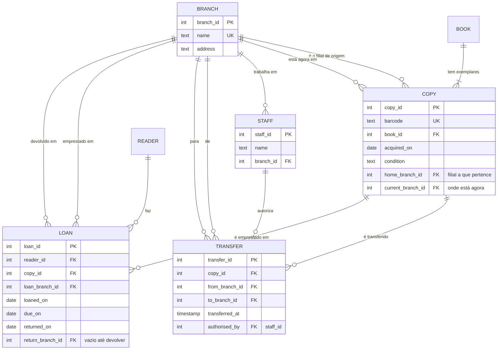

# Challenge 02 — Filiais, transferências e BCNF

## Diagrama ER estendido



`BOOK`, `READER` e as outras tabelas do exercício ficam como estavam.

## Tabelas novas e alteradas

| Tabela | Colunas | PK | FK | UNIQUE |
|---|---|---|---|---|
| `branch` (nova) | branch_id, name, address | branch_id | — | name |
| `staff` (nova) | staff_id, name, branch_id | staff_id | branch_id → branch | — |
| `transfer` (nova) | transfer_id, copy_id, from_branch_id, to_branch_id, transferred_at, authorised_by | transfer_id | copy_id → copy, from_branch_id → branch, to_branch_id → branch, authorised_by → staff | — |
| `copy` (alterada) | + home_branch_id, + current_branch_id | copy_id | + home_branch_id → branch, + current_branch_id → branch | barcode |
| `loan` (alterada) | + loan_branch_id, + return_branch_id | loan_id | + loan_branch_id → branch, + return_branch_id → branch | — |

Regras: `CHECK (from_branch_id <> to_branch_id)` em `transfer`.

**Onde está um exemplar em cada momento.** `copy.current_branch_id` diz onde o exemplar está
agora, sem ler o histórico: muda numa transferência (para `to_branch_id`) e numa devolução
(para `return_branch_id`), na mesma transação que cria a linha de `transfer` ou fecha o
`loan`. Se houver um empréstimo aberto (`returned_on IS NULL`), o exemplar está com o leitor.
O histórico completo fica em `transfer` (cada transferência, com origem, destino, data e quem
autorizou) e em `loan` (onde foi emprestado e onde foi devolvido). Nada se apaga.

## 2. Duas perguntas que o modelo tem de responder

**"Onde está o exemplar X agora?"** — `copy` (a coluna `current_branch_id`) + `branch` para o nome,
e `loan` para saber se está emprestado:

```sql
SELECT c.barcode, b.name AS branch,
       EXISTS (SELECT 1 FROM loan l WHERE l.copy_id = c.copy_id AND l.returned_on IS NULL) AS on_loan
FROM copy c JOIN branch b ON b.branch_id = c.current_branch_id
WHERE c.barcode = 'X';
```

**"Que exemplares saíram da filial Y no mês passado?"** — `transfer` (filtrada por
`from_branch_id` e `transferred_at`) + `copy` e `branch`:

```sql
SELECT c.barcode, t.transferred_at, dest.name AS to_branch, s.name AS authorised_by
FROM transfer t
JOIN copy c      ON c.copy_id = t.copy_id
JOIN branch dest ON dest.branch_id = t.to_branch_id
JOIN staff s     ON s.staff_id = t.authorised_by
WHERE t.from_branch_id = (SELECT branch_id FROM branch WHERE name = 'Y')
  AND t.transferred_at >= date_trunc('month', now()) - interval '1 month'
  AND t.transferred_at <  date_trunc('month', now());
```

## 3. 3NF e BCNF

**A diferença.** Uma tabela está em **3NF** se, para cada dependência funcional `X → A`, ou `X`
é uma superchave, ou `A` faz parte de uma chave candidata. Está em **BCNF** se, para cada
dependência `X → A`, `X` é **sempre** uma superchave. A BCNF tira a exceção "`A` faz parte de
uma chave".

Exemplo: `study_session(reader_id, topic, librarian)` com as regras "cada bibliotecário só
orienta um tema" e "um leitor tem um só bibliotecário por tema". Dependências:

- `(reader_id, topic) → librarian`
- `librarian → topic`

Chaves candidatas: `(reader_id, topic)` e `(reader_id, librarian)`. Está em **3NF**: em
`librarian → topic`, `topic` faz parte de uma chave candidata. Não está em **BCNF**:
`librarian` não é superchave. Consequência: o tema de cada bibliotecário repete-se em cada
linha e pode ficar contraditório. Solução BCNF: `librarian(librarian, topic)` e
`study_session(reader_id, librarian)`.

**No nosso modelo não há nenhuma tabela em 3NF que não esteja em BCNF.** As dependências de cada tabela:

| Tabela | Dependências funcionais | Determinantes | Superchaves? |
|---|---|---|---|
| `reader` | `reader_id → tudo`; `card_number → tudo`; `email → tudo` | reader_id, card_number, email | sim, as três são chaves candidatas |
| `publisher` | `publisher_id → tudo`; `name → tudo` | publisher_id, name | sim |
| `author` | `author_id → name` | author_id | sim |
| `book` | `book_id → tudo`; `isbn → tudo` | book_id, isbn | sim |
| `book_author` | `(book_id, author_id) → author_order`; `(book_id, author_order) → author_id` | os dois pares | sim, os dois são chaves candidatas |
| `copy` | `copy_id → tudo`; `barcode → tudo` | copy_id, barcode | sim |
| `loan` | `loan_id → tudo` | loan_id | sim |
| `reservation` | `reservation_id → tudo` | reservation_id | sim |
| `fine` | `fine_id → tudo`; `loan_id → tudo` | fine_id, loan_id | sim |
| `branch` | `branch_id → tudo`; `name → tudo` | branch_id, name | sim |
| `staff` | `staff_id → name, branch_id` | staff_id | sim |
| `transfer` | `transfer_id → tudo` | transfer_id | sim |

Em todas as tabelas, cada determinante é uma chave candidata, por isso estão em BCNF.
`book_author` é a mais interessante: tem duas chaves candidatas que se sobrepõem
(`book_id` está nas duas), que é o caso típico onde a 3NF e a BCNF podem divergir. Aqui não
divergem, porque `author_order` sozinho não determina nada e o `author_id` sozinho também não.

`loan.due_on` depende de `loaned_on` (`due_on = loaned_on + 14`), que não é chave. Como dado
escrito à mão, isso seria uma dependência transitiva; no modelo é uma coluna gerada pela base
de dados, por isso não pode ficar incoerente (ver o exercício).
