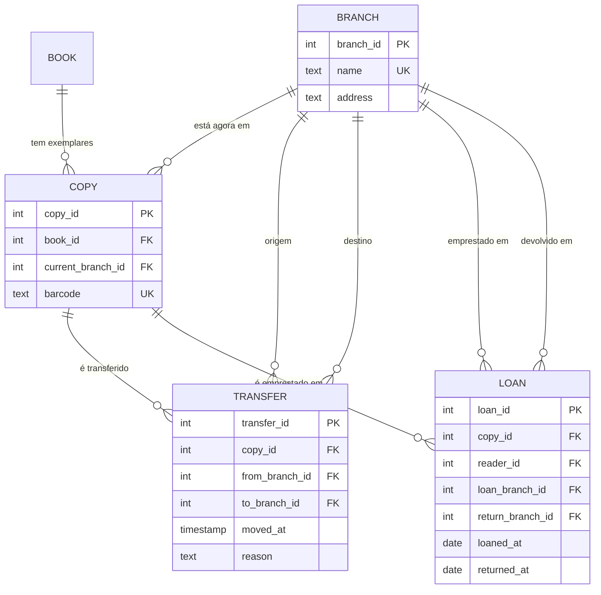

# Challenge 02 — Filiais e transferências

## Diagrama ER (só as partes novas/alteradas)

- `copy.current_branch_id`: onde o exemplar está **agora** (consulta rápida).
- `transfer`: o **histórico completo** de movimentos. Uma devolução noutra
  filial também cria uma linha em `transfer` (reason = `'return'`).
- `loan.return_branch_id`: em que filial o leitor devolveu.

## 3NF mas não BCNF

Exemplo: `transfer(transfer_id, copy_id, moved_at, from_branch_id, to_branch_id)`
se também tivermos a regra "um exemplar não pode ter duas transferências no
mesmo instante", existe a chave candidata `(copy_id, moved_at)`. Como todas as
dependências partem de chaves candidatas, a tabela está em BCNF.

No modelo não existe nenhuma tabela em 3NF que não esteja em BCNF: em todas as
tabelas, cada determinante é uma chave candidata.

**Diferença:** a 3NF permite uma dependência `X → A` em que `X` não é chave,
desde que `A` faça parte de uma chave candidata. A BCNF não permite isso:
todo determinante tem de ser chave candidata. Exemplo clássico (que evitámos):
`workshop(reader_id, theme, librarian)` com as regras "cada bibliotecário só dá
um tema" (`librarian → theme`) e "um leitor tem um bibliotecário por tema".
Chaves candidatas: `(reader_id, theme)` e `(reader_id, librarian)`. Está em 3NF
(`theme` faz parte de uma chave), mas não em BCNF, porque `librarian` não é
chave. Solução: separar em `librarian(librarian, theme)` e
`workshop(reader_id, librarian)`.
