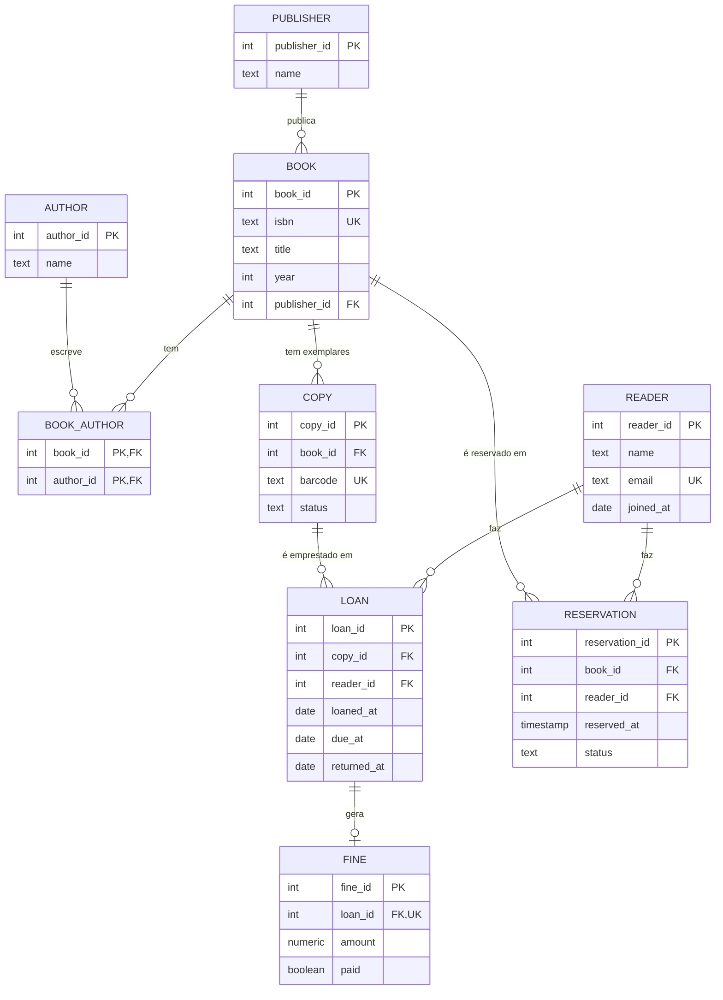

# Exercício 02 — Modelo da biblioteca municipal

## 1. Diagrama ER

## 2. Tabelas (3NF)

| Tabela | PK | FK |
|---|---|---|
| publisher | publisher_id | — |
| author | author_id | — |
| book | book_id | publisher_id → publisher |
| book_author | (book_id, author_id) | book_id → book, author_id → author |
| copy | copy_id | book_id → book |
| reader | reader_id | — |
| loan | loan_id | copy_id → copy, reader_id → reader |
| reservation | reservation_id | book_id → book, reader_id → reader |
| fine | fine_id | loan_id → loan (único: no máximo 1 multa por empréstimo) |

## 3. Desnormalização

Nenhuma. O volume de uma biblioteca é pequeno e as consultas (ex: "livros
emprestados de um leitor") são joins simples e rápidos com índices nas FKs.
O valor da multa é guardado em `fine.amount` porque é um valor histórico
(o preço por dia pode mudar), não um cálculo duplicado.
