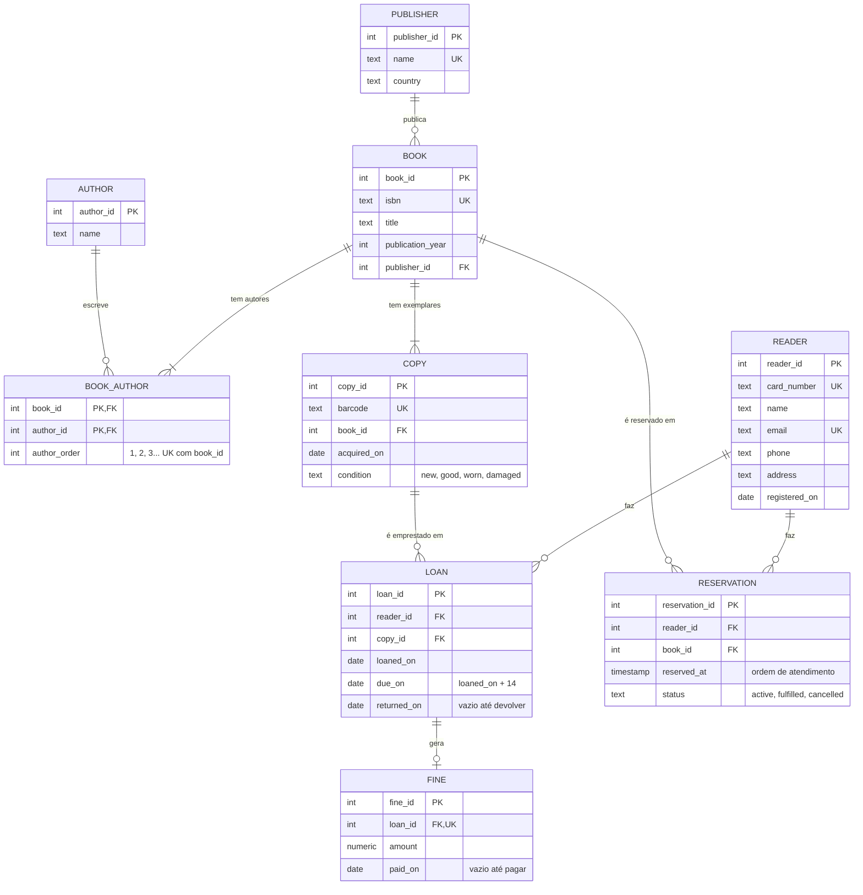

# Exercício 02 — Modelo da biblioteca municipal

## 1. Diagrama ER

Cardinalidades: uma editora tem 0..N livros e um livro tem exatamente 1 editora; um livro tem
1..N autores e um autor 0..N livros (N:N através de `book_author`); um livro tem 1..N exemplares;
um leitor e um exemplar têm 0..N empréstimos; um leitor e um livro têm 0..N reservas; um
empréstimo tem 0..1 multa e uma multa pertence a exatamente 1 empréstimo.

## 2. Tabelas em 3NF

| Tabela | Colunas | PK | FK | UNIQUE |
|---|---|---|---|---|
| `reader` | reader_id, card_number, name, email, phone, address, registered_on | reader_id | — | card_number; email |
| `publisher` | publisher_id, name, country | publisher_id | — | name |
| `author` | author_id, name | author_id | — | — |
| `book` | book_id, isbn, title, publication_year, publisher_id | book_id | publisher_id → publisher | isbn |
| `book_author` | book_id, author_id, author_order | (book_id, author_id) | book_id → book, author_id → author | (book_id, author_order) |
| `copy` | copy_id, barcode, book_id, acquired_on, condition | copy_id | book_id → book | barcode |
| `loan` | loan_id, reader_id, copy_id, loaned_on, due_on, returned_on | loan_id | reader_id → reader, copy_id → copy | — |
| `reservation` | reservation_id, reader_id, book_id, reserved_at, status | reservation_id | reader_id → reader, book_id → book | — |
| `fine` | fine_id, loan_id, amount, paid_on | fine_id | loan_id → loan | loan_id |

`book_author` é a tabela de associação do N:N livro–autor e guarda a ordem dos autores
(`author_order`); o `UNIQUE (book_id, author_order)` impede dois "primeiros autores" no mesmo livro.

Todas as tabelas estão em 3NF: cada coluna não-chave depende só da chave inteira e de mais
nada (o nome do autor está só em `author`, a editora só em `publisher`, o livro de um
exemplar só em `copy`). A única exceção aparente é `loan.due_on`, que depende de `loaned_on`;
por isso é uma coluna **gerada** pela base de dados (`loaned_on + 14`), e não um dado que
alguém escreve e possa contradizer `loaned_on`.

## 3. Regras que a estrutura das tabelas não garante sozinha

| Regra | Onde a garantir |
|---|---|
| `condition` só pode ser `new`, `good`, `worn` ou `damaged` | constraint: `CHECK` |
| `status` da reserva só pode ser `active`, `fulfilled` ou `cancelled` | constraint: `CHECK` |
| a data prevista de devolução é 14 dias depois do empréstimo | estrutura: coluna gerada `due_on date GENERATED ALWAYS AS (loaned_on + 14) STORED` (nunca pode ficar diferente) |
| a devolução não pode ser antes do empréstimo | constraint: `CHECK (returned_on >= loaned_on)` |
| um exemplar está no máximo num empréstimo aberto | constraint: índice único parcial `ON loan (copy_id) WHERE returned_on IS NULL` |
| um leitor tem no máximo 5 empréstimos abertos | trigger `BEFORE INSERT` em `loan` que conta os abertos do leitor (com lock na linha do leitor, para dois empréstimos ao mesmo tempo não passarem os dois) |
| um livro tem pelo menos um autor | trigger de constraint diferido (`DEFERRABLE INITIALLY DEFERRED`), verificado no `COMMIT`, ou a aplicação |
| a biblioteca tem pelo menos um exemplar de cada livro | aplicação (o livro e o primeiro exemplar são criados na mesma transação) |
| só se reserva um livro quando não há exemplar disponível | aplicação (ou trigger), porque depende do estado de outras tabelas naquele momento |
| as reservas de um livro são atendidas pela ordem em que foram feitas | aplicação: escolhe a reserva `active` com o `reserved_at` mais antigo (`ORDER BY reserved_at`) |
| uma devolução atrasada cria uma multa de 0.50 por dia de atraso | trigger `AFTER UPDATE OF returned_on` em `loan` (ou a aplicação, na mesma transação da devolução) |
| o valor da multa é positivo | constraint: `CHECK (amount > 0)` |

## 4. Desnormalização

Nenhuma. O volume de uma biblioteca municipal é pequeno (milhares de livros, não milhões) e
as perguntas do dia a dia ("que livros tem este leitor?", "há algum exemplar livre?") são
joins simples, rápidos com índices nas chaves estrangeiras. Copiar dados (por exemplo o título
do livro no empréstimo) obrigava a manter as cópias iguais e não traz ganho visível.

Nota: `fine.amount` não é uma desnormalização. É o valor que foi cobrado naquele momento e tem
de ficar assim mesmo que a regra de 0.50 por dia mude no futuro.
