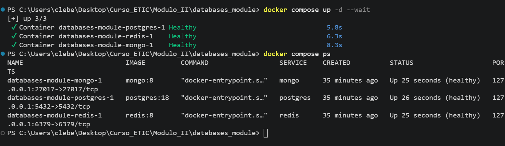

# Exercício 01 — Diagnóstico dos motores de banco de dados

## 1. Motores em execução

A captura abaixo foi feita depois de executar `docker compose up -d --wait` e
`docker compose ps`. Os três serviços aparecem como saudáveis:



Os serviços são:

| Serviço | Motor | Persistência configurada |
|---|---|---|
| `postgres` | PostgreSQL 18 | volume Docker `postgres_data` |
| `mongo` | MongoDB 8 | volume Docker `mongo_data` |
| `redis` | Redis 8 | volume Docker `redis_data` |

## 2. Modelo de dados

### PostgreSQL

O FastAPI cria a tabela `hello` em
[`fastapi/app/clients.py`](./fastapi/app/clients.py):

| Tabela | Coluna | Tipo/regra |
|---|---|---|
| `hello` | `id` | inteiro gerado pelo banco, chave primária |
| `hello` | `msg` | `text`, obrigatório |
| `hello` | `created_at` | `timestamptz`, obrigatório, padrão `now()` |

Não há relacionamentos entre tabelas: o banco relacional possui somente
`hello`, sem chave estrangeira e sem tabela associativa. Cada chamada
`POST /hello` insere uma linha.

### MongoDB

Na coleção `hello` do banco definido por `MONGO_DB`, cada documento tem:

```json
{
  "_id": "gerado pelo MongoDB",
  "msg": "texto",
  "tags": ["a", "b"],
  "created_at": "data/hora UTC"
}
```

Não há referências entre documentos. `tags` é uma lista embutida no próprio
documento.

### Redis

O modelo é composto por duas chaves globais, sem relacionamentos:

| Chave | Valor | Significado |
|---|---|---|
| `hello:last` | string | mensagem escrita mais recentemente |
| `hello:count` | inteiro | contador de chamadas |

Assim, o PostgreSQL é o único dos três que mantém um histórico consultável de
mensagens. O código atual não define uma fonte de verdade formal nem uma
transação distribuída entre os motores.

## 3. Três problemas concretos

A análise detalhada está no arquivo separado
[`problemas-do-modelo.md`](./problemas-do-modelo.md).

## 4. 100.000 registros e duas escritas simultâneas

A análise está no arquivo separado
[`registros-e-escritas-ao-mesmo-tempo.md`](./registros-e-escritas-ao-mesmo-tempo.md).

## 5. MongoDB ou Redis?

A explicação está no arquivo separado
[`mongodb-ou-redis.md`](./mongodb-ou-redis.md).

## Challenge

O script do desafio está na pasta
[`challange`](../challange/), com instruções em
[`challange/README.md`](../challange/README.md).