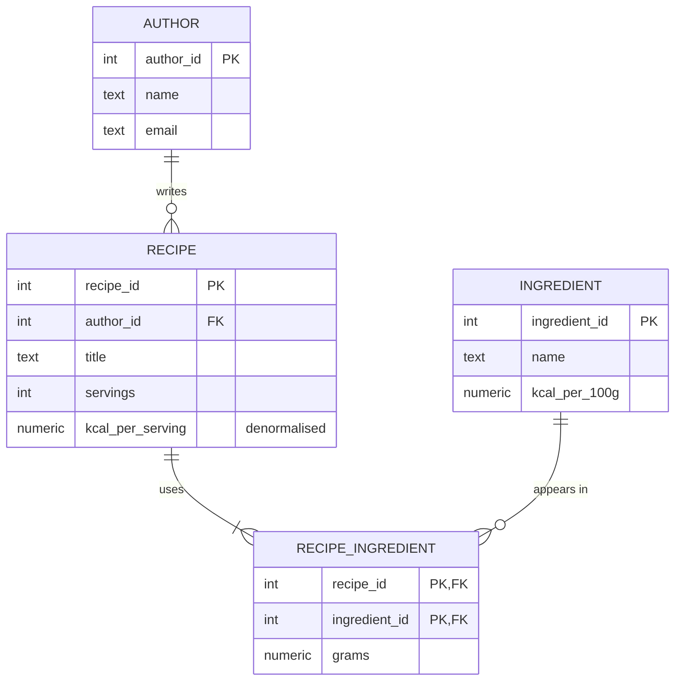

# Session 02 in Django: normalising the recipe spreadsheet

The recipe spreadsheet from the session 02 tutorial split into `author`, `recipe`, `ingredient` and `recipe_ingredient`, with `kcal_per_serving` stored on `recipe` as a deliberate denormalisation.

| File | What it shows |
|------|---------------|
| `demo/models.py` | The four tables as models. `RecipeIngredient` has a composite primary key `(recipe_id, ingredient_id)` and the `grams` of the N:N relationship. Only PK, FK and NOT NULL here; constraints come in session 03. |
| `demo/services.py` | `replace_ingredients()` deletes the old lines, inserts the new ones and recalculates `kcal_per_serving` in one `transaction.atomic()` block. |
| `demo/views.py` | `POST /recipes`, `GET /recipes` (reads the stored value, no join, and returns the SQL it ran), `GET /recipes/<id>`, `PUT /recipes/<id>/ingredients`. |
| `demo/management/commands/seed.py` | The three spreadsheet rows, normalised: two authors, three ingredients, two recipes. |
| `demo/migrations/0001_initial.py` | The `CREATE TABLE` statements Django generated. Print them with `uv run python manage.py sqlmigrate demo 0001`. |



Denormalisation decision: the listing page shows calories per serving for every recipe, so `recipe.kcal_per_serving` stores it. The cost is that every change to a recipe's ingredients must recalculate it, which `replace_ingredients()` does in the same transaction. Changing an ingredient's `kcal_per_100g` would also make the stored values stale; this example has no endpoint for that, and a real one would have to recalculate every recipe that uses the ingredient.

## Run it

From the root of the repository:

```bash
docker compose up -d
./scripts/create-db.sh s02_django
```

Then, in this folder:

```bash
cp .env.example .env
uv sync
uv run python manage.py migrate
uv run python manage.py seed
uv run python manage.py runserver 8001
```

`uv sync` creates `.venv/` with the Python version and the exact package versions in `uv.lock`. The dependencies are declared in `pyproject.toml`.

```bash
curl localhost:8001/recipes
curl localhost:8001/recipes/1
curl -X POST localhost:8001/recipes -H 'content-type: application/json' \
  -d '{"author_id": 1, "title": "Milk pudding", "servings": 2, "ingredients": [{"ingredient_id": 2, "grams": 500}, {"ingredient_id": 1, "grams": 40}]}'
curl -X PUT localhost:8001/recipes/3/ingredients -H 'content-type: application/json' \
  -d '{"ingredients": [{"ingredient_id": 2, "grams": 250}]}'
```

The seed gives Pancakes 213.5 kcal per serving (200 g of flour and 300 g of milk, 4 servings) and Omelette 186.0.

## Things to try

Open a shell with `uv run python manage.py dbshell` (needs `psql` installed) or `docker compose exec postgres psql -U postgres -d s02_django` from the repository root, and check that each anomaly from the tutorial is gone:

- Update anomaly: `UPDATE author SET email = 'ana@new.example' WHERE name = 'Ana';` changes one row, and every recipe by Ana shows the new email in `GET /recipes/1`. In the spreadsheet you had to change one row per ingredient line.
- Insertion anomaly: `INSERT INTO ingredient (name, kcal_per_100g) VALUES ('Sugar', 387);` works although no recipe uses sugar yet.
- Deletion anomaly: `DELETE FROM recipe_ingredient WHERE recipe_id = 2; DELETE FROM recipe WHERE recipe_id = 2;` removes the omelette, and `SELECT * FROM author;` still lists Rui.
- Send a `PUT /recipes/3/ingredients` with an `ingredient_id` that does not exist. The response is 422 and `GET /recipes/3` shows the old lines and the old `kcal_per_serving`: the delete, the insert and the recalculation were rolled back together.
- Compare the SQL returned by `GET /recipes` with the query you would need without the stored column (a `JOIN` to `recipe_ingredient` and `ingredient` with `SUM(...) GROUP BY`).
- `INSERT INTO author (name, email) VALUES ('Ana', 'ana@example.com');` is accepted: nothing stops a duplicate email yet. Session 03 adds the `UNIQUE` and `CHECK` constraints.
