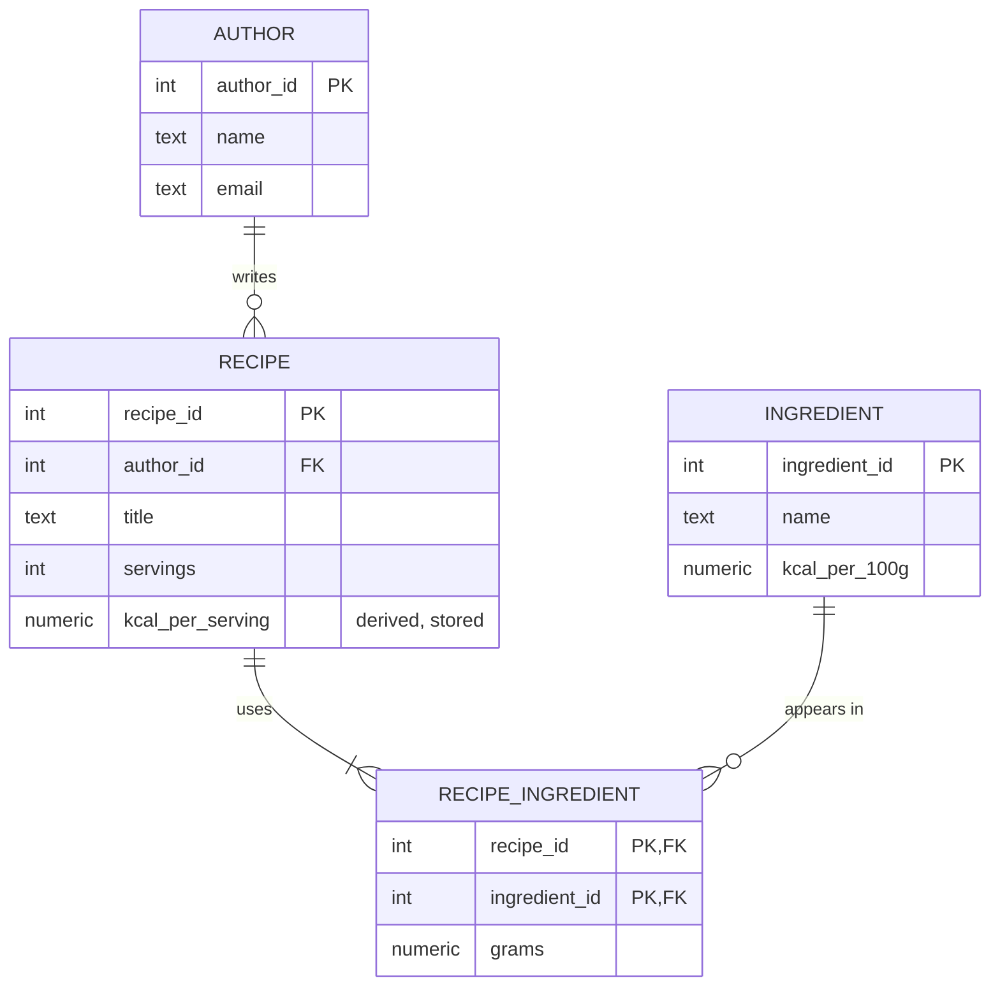

# Session 02 in FastAPI: modelling and normalisation

The recipe spreadsheet from the session 02 tutorial, normalised into `author`, `recipe`, `ingredient` and `recipe_ingredient`, with one deliberate denormalisation: `kcal_per_serving` stored on `recipe`.

| File | What it shows |
|------|---------------|
| `sql/schema.sql` | The four tables with primary keys, foreign keys and `NOT NULL`. Full constraints (`CHECK`, `UNIQUE`, `ON DELETE`) are session 03. |
| `sql/seed.sql` | The three spreadsheet rows, with each fact stored once. |
| `scripts/init_db.py` | Recreates the tables and loads the seed. |
| `app/db.py` | Opens a `psycopg` connection with rows returned as dictionaries. |
| `app/main.py` | `POST /recipes` creates a recipe with its ingredients. `GET /recipes` reads the stored `kcal_per_serving` without a join. `GET /recipes/{id}` joins the author and ingredients back. `PUT /recipes/{id}/ingredients` replaces the list and recalculates `kcal_per_serving` in the same transaction. |

## The model



Denormalisation decision: the listing page shows calories per serving for every recipe, so `recipe.kcal_per_serving` stores the result of `sum(grams * kcal_per_100g / 100) / servings`. The cost is that every change to a recipe's ingredients must recalculate it in the same transaction (`RECALCULATE_KCAL` in `app/main.py`). A change to an ingredient's `kcal_per_100g` would also need to recalculate every recipe that uses it; this example does not expose that operation.

The spreadsheet has no servings column, so the seed sets Pancakes to 4 servings and the Omelette to 1.

## Run it

From the root of the repository, start the engines and create this project's database:

```bash
docker compose up -d
./scripts/create-db.sh s02_fastapi
```

Then, in this folder:

```bash
cp .env.example .env
uv sync
uv run python -m scripts.init_db
uv run uvicorn app.main:app --reload --port 8000
```

`uv sync` creates `.venv/` with the Python version and the exact package versions in `uv.lock`. The dependencies are declared in `pyproject.toml`.

Open http://127.0.0.1:8000/docs, or use `curl`:

```bash
curl localhost:8000/recipes
curl localhost:8000/recipes/1
curl -X POST localhost:8000/recipes -H 'content-type: application/json' \
  -d '{"author_id": 2, "title": "Scrambled eggs", "servings": 2,
       "ingredients": [{"ingredient_id": 3, "grams": 240}, {"ingredient_id": 2, "grams": 60}]}'
curl -X PUT localhost:8000/recipes/1/ingredients -H 'content-type: application/json' \
  -d '[{"ingredient_id": 1, "grams": 250}, {"ingredient_id": 2, "grams": 300}, {"ingredient_id": 3, "grams": 100}]'
curl localhost:8000/recipes
```

After the `PUT`, the listing shows Pancakes at 297.8 kcal per serving instead of 213.5.

## Things to try

Open `psql` on the project's database from the repository root:

```bash
docker compose exec postgres psql -U postgres -d s02_fastapi
```

Each anomaly from the spreadsheet is now impossible:

- Update anomaly. Change flour's calories in one place: `UPDATE ingredient SET kcal_per_100g = 360 WHERE name = 'Flour';` There is only one row to change, and Ana's email lives in a single `author` row. Then look at `SELECT title, kcal_per_serving FROM recipe;`: Pancakes still shows 297.8, although with the new flour value it should be 295.3. The stored value is now stale. That is the price of the denormalisation, and the reason the recalculation must run whenever its inputs change.
- Insertion anomaly. Add an ingredient no recipe uses yet: `INSERT INTO ingredient (name, kcal_per_100g) VALUES ('Sugar', 387);`
- Deletion anomaly. Delete the Omelette and its lines: `DELETE FROM recipe_ingredient WHERE recipe_id = 2; DELETE FROM recipe WHERE recipe_id = 2;` Rui is still in `author`.
- Try `DELETE FROM recipe WHERE recipe_id = 1;` without deleting its lines first. The foreign key refuses it. Session 03 chooses `ON DELETE CASCADE` for this relationship.
- Send `PUT /recipes/1/ingredients` with an `ingredient_id` that does not exist. The response is 422 and `GET /recipes/1` is unchanged: the `DELETE` that ran before the failing `INSERT` was rolled back with it.
- Insert two authors with the same email. Nothing stops it yet; session 03 adds the `UNIQUE` constraint.
