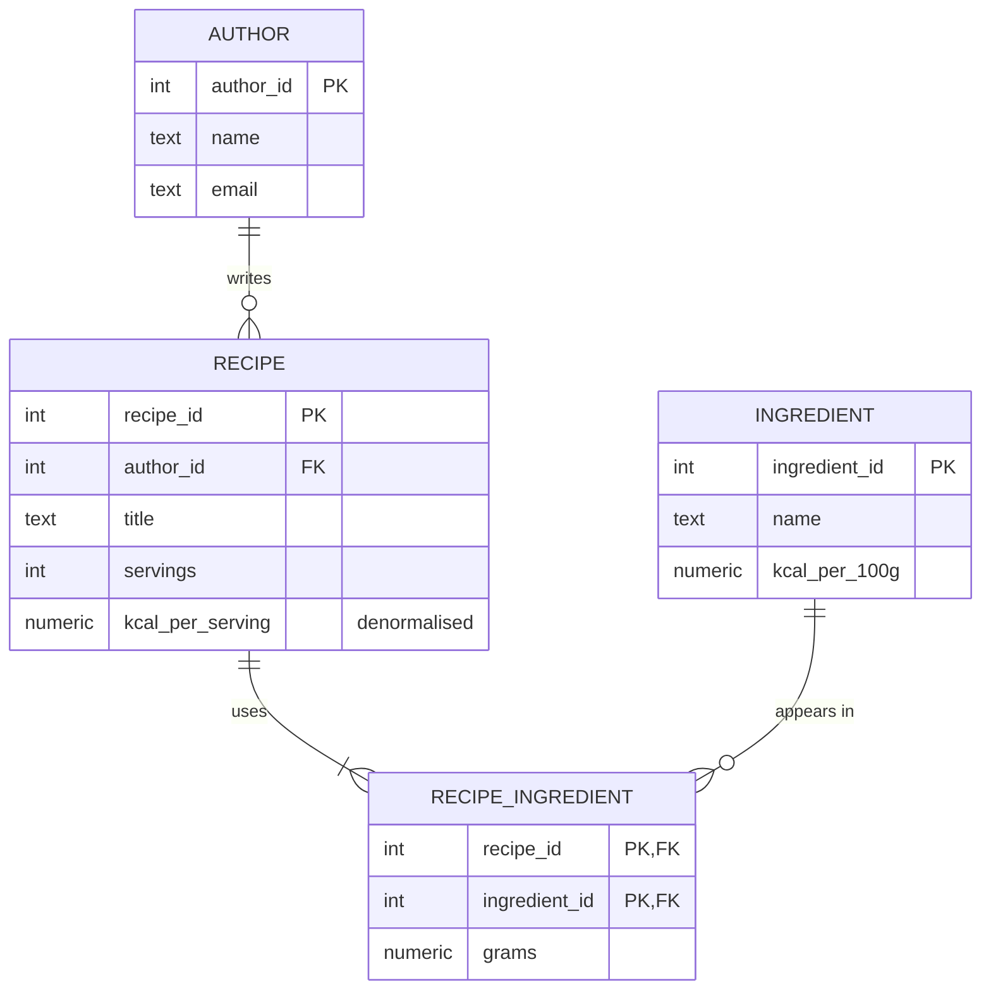

# Session 02 in Next.js with Prisma: modelling and normalisation

The recipe spreadsheet from the tutorial, normalised into four tables, with one deliberate denormalisation: `kcal_per_serving` is stored on `recipe` and recalculated whenever the ingredients change.

| File | What it shows |
|------|---------------|
| `prisma/schema.prisma` | The four tables as Prisma models: primary keys, foreign keys and `NOT NULL` only. |
| `prisma/migrations/*/migration.sql` | The SQL Prisma generated from the models. |
| `src/lib/recipes.ts` | `recalculateKcal`: the code that keeps the stored value in line with the ingredients. |
| `src/app/api/recipes/route.ts` | `GET /api/recipes` reads the stored value (one table, no join). `POST /api/recipes` creates a recipe and its lines in one transaction. |
| `src/app/api/recipes/[id]/route.ts` | `GET` the detail with author and ingredients (joins). `DELETE` a recipe and its lines. |
| `src/app/api/recipes/[id]/ingredients/route.ts` | `PUT` replaces the ingredient list and recalculates `kcal_per_serving` in the same transaction. |
| `src/app/api/ingredients/route.ts` | `GET` and `POST` ingredients. |
| `src/app/api/authors/route.ts` | `GET` authors with their number of recipes. |
| `scripts/seed.ts` | The three spreadsheet rows, normalised. |

## The model



Each fact lives in the table it depends on: the email on `author`, the calories on `ingredient`, the title on `recipe`, the grams on the recipe-ingredient pair. `UNIQUE` on `email` and `ingredient.name`, and the `CHECK` rules, are added in session 03.

**Denormalisation decision.** The listing page shows calories per serving for every recipe. We store `kcal_per_serving` on `recipe` so the listing reads one column instead of summing the ingredients of each recipe. The price: every write that changes a recipe's ingredients or servings must call `recalculateKcal` inside the same transaction. Here that is `POST /api/recipes` and `PUT /api/recipes/:id/ingredients`. Changing `ingredient.kcal_per_100g` would leave stored values stale; this project does not offer that operation.

Decimal columns come back as strings in the JSON (`"213.5"`). Prisma uses a decimal type rather than a JavaScript number so that no precision is lost.

## Run it

From the root of the repository, start the engines and create this project's database:

```bash
docker compose up -d
./scripts/create-db.sh s02_nextjs
```

Then, in this folder:

```bash
cp .env.example .env
npm install
npx prisma migrate dev
npm run seed
npm run dev
```

`npm run seed` empties the four tables and loads the tutorial's data again, so you can run it whenever you want to start over.

```bash
curl localhost:3000/api/recipes
curl localhost:3000/api/recipes/1
curl -X POST localhost:3000/api/ingredients -H 'content-type: application/json' \
  -d '{"name": "Sugar", "kcalPer100g": 387}'
curl -X POST localhost:3000/api/recipes -H 'content-type: application/json' \
  -d '{"authorId": 1, "title": "Crepes", "servings": 2, "ingredients": [{"ingredientId": 1, "grams": 100}, {"ingredientId": 2, "grams": 250}]}'
curl -X PUT localhost:3000/api/recipes/3/ingredients -H 'content-type: application/json' \
  -d '[{"ingredientId": 1, "grams": 150}, {"ingredientId": 2, "grams": 250}, {"ingredientId": 4, "grams": 10}]'
curl localhost:3000/api/recipes
```

## Things to try

Open `psql` on this project's database to look at the tables directly:

```bash
docker compose exec postgres psql -U postgres -d s02_nextjs
```

- **Update anomaly is gone.** Ana's email is stored once. `UPDATE author SET email = 'ana@new.example' WHERE author_id = 1;` reports `UPDATE 1`, and `GET /api/recipes/1` shows the new email. The same goes for the calories of flour: one row in `ingredient`, whatever the number of recipes using it.
- **Insertion anomaly is gone.** `POST /api/ingredients` adds Sugar before any recipe uses it. In the spreadsheet you could not add a row without a recipe.
- **Deletion anomaly is gone.** `curl -X DELETE localhost:3000/api/recipes/2` deletes the Omelette. `GET /api/authors` still lists Rui, now with 0 recipes.
- Change the servings of a recipe in `psql` (`UPDATE recipe SET servings = 8 WHERE recipe_id = 1;`) and list the recipes again. The stored kcal is now wrong, because this write path skipped `recalculateKcal`. This is the risk you accept with a denormalisation; write it down next to the decision.
- Compare the listing query with the detail query in the logs: add `log: ["query"]` to the `PrismaClient` options in `src/lib/prisma.ts` and call both endpoints.
